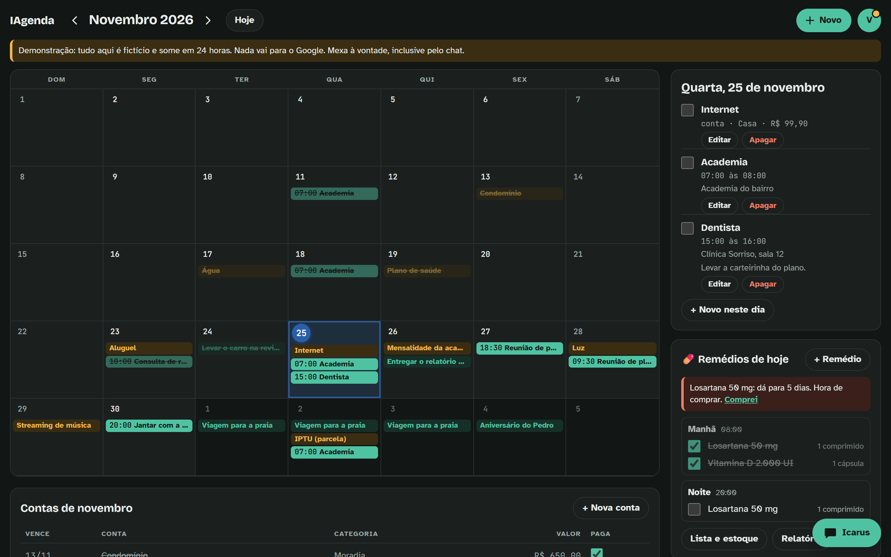
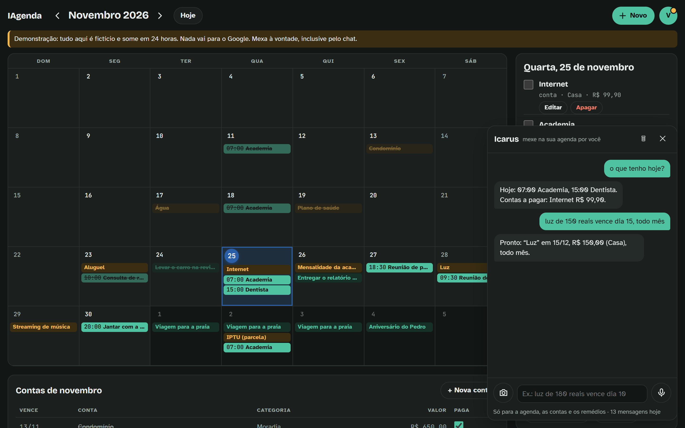
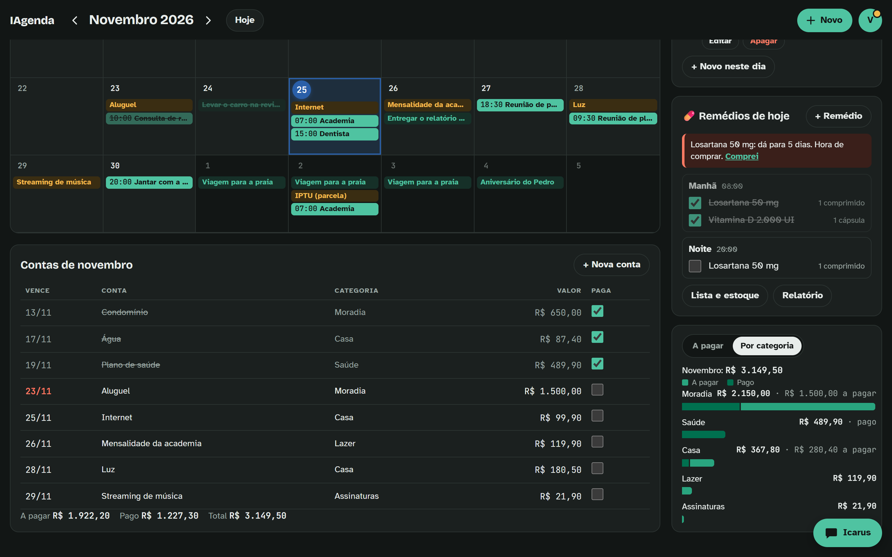
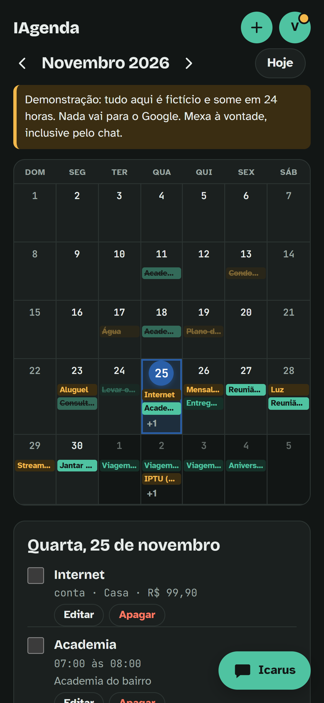

# IAgenda

[](https://github.com/icarocarvalhomessias/iagenda/actions/workflows/testes.yml) [](LICENSE)

**English** · [Português](README.pt-BR.md)

A Google Calendar with an AI chat that looks after it for you. You sign in with Google, see your month, and ask the chat (by text, photo or voice) to create, change, delete or check off events. Besides appointments, IAgenda tracks **bills to pay** and **medications**, and sends **push notifications** to your phone.

A personal, open-source (MIT) project by Icaro Carvalho, built to help people stay organized without having to stop and get organized. It runs for a small group of invited people, and you can host your own.



| Chat | Bills by category | Phone |
|---|---|---|
|  |  |  |

All screenshots come from the demo mode, with fictitious data. The app, and most of the code, are in Brazilian Portuguese.

## Features

- **Month view** read straight from the person's Google Calendar. No events are copied to the server: Google Calendar stays the source of truth.
- **Chat with Icarus**, the assistant, using tool calls (`listar_eventos`, `criar_evento`, `editar_evento`, `remover_evento`, `marcar_feito` and the medication tools). The AI is swappable: Anthropic (default), OpenAI, Gemini, Ollama (on your own server) or any OpenAI-compatible API.
  - Photo of a bill, invoice, invitation or medicine box: the AI extracts what it needs (amount, due date, date, box details).
  - Voice: transcribed on the server itself with whisper.cpp and deleted right after.
- **Bills to pay**: an all-day event type, with amount and category stored in Google's `extendedProperties.private`. Marking one as paid adds "✓" to the title.
- **Medications**: dose, times of day and units per box; stock computed from movements; a daily check-in; and a report of missed doses. This is health data: it lives only in the server's SQLite, per person, and never goes to Google.
- **Push notifications** (Web Push): "today" in the morning, "tomorrow" in the evening, 1 hour before each timed event, medication times and medication running out.
- **Features each person turns on or off** (Appointments, Bills, Medications): when off, a feature disappears from the page, the chat and the notifications.
- Installable PWA.
- **Demo mode** (optional): "Experimentar sem conta" ("try it without an account") opens a sample calendar stored on the server, so anyone can try IAgenda without handing over their Google account.

## Security

The chat touches other people's real data, so a good part of the code is about limits:

- **Three locks against off-topic use**: a server-side filter before the AI (attack phrases, commands, encoded blobs); a `fora_do_assunto` ("off topic") tool that the AI calls for anything else, answered by the server with a fixed sentence; and a pause of the chat after a few off-topic requests in a day.
- **Deleting, or changing a whole recurring series, never happens on the AI's word alone**: it becomes a pending request that only the "Confirmar" button on screen executes.
- Invitation titles and descriptions are treated as data, never as instructions (anyone can send you an invite).
- Per-message limits (how many events can be created, changed or deleted) and per-day limits.
- Google sign-in done by the server itself (OAuth 2.0 with PKCE and a `state` bound to a browser cookie), only for invited e-mails.
- The Google refresh token is stored in SQLite encrypted with AES-256-GCM; the access token lives only in memory. The browser only gets a random session cookie (`HttpOnly; SameSite=Strict; Secure`), and the database stores only its hash.
- "Sign out and disconnect Google" revokes the authorization at Google and deletes the person, the chat, the medications and the notifications.
- Strict CSP, every piece of text coming from Google is rendered with `textContent`, and origin checks on every route that changes something.
- Web Push implemented with `node:crypto` only (RFC 8291, `aes128gcm` and an ES256 VAPID JWT), accepting only the browsers' push hosts.
- In production, the systemd service runs as its own user, without sudo and with a locked-down filesystem (`deploy/agenda-web.service`).

## Stack

- Node 22+ running TypeScript directly (Node's type stripping), no build step.
- `node:http`, `node:sqlite` and `node:crypto`; the only dependency is the Anthropic SDK (other providers go through `fetch`). For development, only `typescript` and `@types/node` (type checking).
- Tests with `node:test`, no test library.
- Plain HTML, CSS and JavaScript front end (`publico/`).

## Files

| File | What it does |
|---|---|
| `servidor.ts` | HTTP server, `/auth/*` and `/app/*` routes, session, security headers |
| `auth.ts` | Google sign-in, invitations, sessions and the encrypted refresh token |
| `admin.ts` | Command line: invite, uninvite, list and delete people |
| `agenda.ts` | Google Calendar: list, create, edit, delete, check off |
| `chat.ts` | Chat: prompt, tools, locks, confirmation, photo and voice |
| `ia.ts` | The chat's AI: Anthropic or an OpenAI-compatible API (translates messages and tools) |
| `remedios.ts` | Medications, stock, doses and report |
| `push.ts` | Web Push and the notification round every 5 minutes |
| `funcoes.ts` | Features turned on and off per person |
| `demo.ts` | Demo mode: visitor without an account, sample data and cleanup |
| `calendario-local.ts` | A calendar stored in SQLite that answers like Google Calendar (used by the demo) |
| `apagar.ts` | Delete everything about a person (disconnect, `admin.ts apagar`, a visitor leaving) |
| `banco.ts` | SQLite |
| `config.ts` | Reading secrets (variable, file or systemd credential) |
| `publico/` | The page (calendar, chat, medications) and the privacy policy |
| `teste/` | Fake servers (Google sign-in, Google Calendar, Anthropic and an OpenAI-compatible API) to run everything locally with fictitious data |
| `teste/auto/` | Automated tests (`npm test`) |
| `.github/` | CI: tests, types, Docker image and secret scanning |
| `Dockerfile`, `docker-compose.yml`, `.env.example` | Hosting with Docker |
| `deploy/` | Caddyfile (HTTPS) and a sample systemd service |

## Run it locally

No Google account or API key needed: `teste/falso.ts` fakes Google sign-in, Google Calendar and the Anthropic API with fictitious data.

```
npm install
npm run local
```

Then open <http://127.0.0.1:8091> (use `127.0.0.1`, not `localhost`) and click "Entrar com Google". The fake sign-in page lets you pick each case: the invited person, someone without an invitation, someone who unticks the calendar permission, and someone who cancels. "Experimentar sem conta" opens the demo mode.

## Tests

```
npm test         # unit and end-to-end
npm run tipos    # type checking (strict TypeScript), nothing is compiled
```

- **Unit**: validation of events and bills, the local calendar (recurrences, exceptions, months without a 31st, daylight saving time), notification timing, chat locks, medications (stock, doses, report), sessions and the start of the sign-in flow (PKCE, `state`).
- **End-to-end** (`teste/auto/servidor.test.ts`): starts the real `servidor.ts` against `teste/falso.ts` on their own ports and goes through Google sign-in (invited, not invited, missing calendar permission, cancelled), security headers, CSRF protection, creating and deleting events, the chat with confirmation and the off-topic lock, the demo (with zero requests to Google), disconnecting (which revokes the authorization), and the whole chat with an OpenAI-compatible AI (tools, photo, confirmation and medicine-box reading, all through `ia.ts`'s translation).
- No test talks to a real service or needs a key.

GitHub Actions (`.github/workflows/testes.yml`) runs the tests and type checks on Node 22 and 24, builds the Docker image and checks the container starting in demo mode, and scans the history for secrets with gitleaks.

`teste/trava-ia.ts` is separate: it checks the chat's locks against the real AI (costs a few cents) and is only run by hand.

## Demo mode

With `AGENDA_DEMO=1`, the sign-in page gets a **Experimentar sem conta** button. Each visitor gets a calendar of their own, with bills (one overdue, one due today, last month's already paid), appointments (an invitation from someone else, a weekly series, a multi-day trip) and two medications with the last week of check-ins, all dated around today.

- Nothing goes to Google: the visitor's calendar lives in SQLite (`calendario-local.ts`), which answers like the Google Calendar API. That is why the page, the chat and the notifications run exactly the same code as for people signed in with Google.
- A visitor lasts `AGENDA_DEMO_HORAS` (24 h) and is deleted on sign-out. At most `AGENDA_DEMO_MAX` visitors at once, and 5 sign-ins per minute per IP.
- The chat uses the configured AI, if any, with its own limits: `AGENDA_DEMO_CHAT_DIA` messages per visitor and `AGENDA_DEMO_CHAT_TOTAL` per day across all visitors (the demo's spending cap). Without a key, the demo works without the chat.
- It can run alongside Google sign-in (invited people sign in with Google, everyone else tries the demo) or on its own: without `AGENDA_GOOGLE_CLIENT_ID`, only the demo button shows.

## Host it with Docker

You need a server with Docker, a domain pointing to it and a Google OAuth client (next section).

```
git clone https://github.com/icarocarvalhomessias/iagenda.git && cd iagenda
cp .env.example .env          # fill in: AGENDA_SITE, AGENDA_DOMINIO, the Google client and the master key
docker compose --profile https up -d
docker compose exec iagenda node admin.ts convidar someone@gmail.com
```

The `https` profile puts [Caddy](https://caddyserver.com/) in front, with an automatic certificate for `AGENDA_DOMINIO`; in that case set `AGENDA_PROXY=1`. Without the profile, IAgenda only listens on `http://127.0.0.1:8091`, to sit behind the proxy you already have.

- The data (people, chats, medications, notification keys) lives in the `iagenda-dados` volume. Back it up **and** back up `AGENDA_CHAVE_MESTRA`, which lives in `.env`, outside the volume: without it, the stored authorizations can't be decrypted and everyone has to sign in again.
- Update: `git pull && docker compose --profile https up -d --build`.
- Voice messages need [whisper.cpp](https://github.com/ggml-org/whisper.cpp), which is not in the image. Without it, the microphone button is hidden and everything else works.

Without Docker, on Node 22.18 or newer: `npm ci --omit=dev`, the same variables as `.env.example`, and `npm start`. `deploy/agenda-web.service` has a sample systemd service, with secrets via `LoadCredential`.

## The chat's AI

The chat always speaks the Anthropic Messages API format; `ia.ts` sends it straight to Anthropic or translates it to the OpenAI chat API (messages, images, tools and tool results). The prompt, the tools and the locks are the same for every provider, and the server checks every action the AI takes the same way.

| `AGENDA_IA` | Needs | Notes |
|---|---|---|
| `anthropic` (default) | `AGENDA_ANTHROPIC_CHAVE` | Default model `claude-opus-5-5`, with effort (`AGENDA_ESFORCO`) and prompt caching |
| `openai` | `AGENDA_IA_CHAVE` (or `OPENAI_API_KEY`) and `AGENDA_MODELO` | |
| `gemini` | `AGENDA_IA_CHAVE` (or `GEMINI_API_KEY`) and `AGENDA_MODELO` | Through Gemini's OpenAI-compatible API |
| `ollama` | `AGENDA_MODELO` | Runs on your own server (`http://127.0.0.1:11434/v1`), no key, and the data never leaves it |
| `compativel` | `AGENDA_IA_URL` and `AGENDA_MODELO` (plus a key, if required) | OpenRouter, Groq, LM Studio, vLLM... |

`AGENDA_MODELO` is the model name as the provider calls it. Prefer a model that is good at tool use and reads images (bill photos, medicine boxes): a model that is too small gets the tools wrong more often. To check the locks with the AI you picked, run `node teste/trava-ia.ts` with the same variables (costs a few cents).

To try it locally with Ollama: `AGENDA_IA=ollama AGENDA_MODELO=<model> npm run local`.

## Google sign-in

1. In the [Google Cloud Console](https://console.cloud.google.com/), create a project and enable the **Google Calendar API**.
2. On the "OAuth consent screen", choose the external type and add the scopes `openid`, `email`, `profile` and `.../auth/calendar.events`. Published "In production" without verification, the app accepts up to 100 people (with the "unverified app" warning); in "Testing", sign-ins expire every 7 days.
3. Under "Credentials", create an **OAuth client ID** of type "Web application", with the redirect URI `https://YOUR-DOMAIN/auth/google/retorno` (to test locally, also `http://127.0.0.1:8091/auth/google/retorno`).
4. Set `AGENDA_SITE`, `AGENDA_GOOGLE_CLIENT_ID` and the client secret (table below).
5. Invite who may sign in:

```
node admin.ts convidar someone@gmail.com
node admin.ts listar
node admin.ts tirar someone@gmail.com      # closes their sessions; the data stays
node admin.ts apagar someone@gmail.com     # revokes at Google and deletes everything about the person
```

Or use `AGENDA_CONVITES=someone@gmail.com,other@gmail.com` (`*` lets any Google account in).

Run `admin.ts` with the same variables as the server (at least `AGENDA_DADOS` and `AGENDA_CHAVE_MESTRA`), so it uses the same database. With Docker, `docker compose exec iagenda node admin.ts ...` already does that.

## Environment variables

Secrets (marked 🔑) can be given three ways: the value itself (`NAME=...`), a file (`NAME_ARQUIVO=/run/secrets/...`) or a systemd credential (`LoadCredential`, name in parentheses).

| Variable | Default | Purpose |
|---|---|---|
| `AGENDA_SITE` | `http://127.0.0.1:8091` | Public address: sign-in redirect and notification links. With `https://`, the cookie gets `Secure` |
| `AGENDA_HOST`, `AGENDA_PORTA` | `127.0.0.1`, `8091` | Where the server listens (`0.0.0.0` in Docker) |
| `AGENDA_PROXY` | `0` | `1` behind a reverse proxy: the rate-limit IP comes from `X-Forwarded-For` |
| `AGENDA_GOOGLE_CLIENT_ID` | | Google OAuth client ID |
| `AGENDA_GOOGLE_CLIENT_SECRET` 🔑 | | Client secret (`google-client-secret`) |
| `AGENDA_CHAVE_MESTRA` 🔑 | generated in `dados/` | 32 bytes in base64 or hex (`openssl rand -base64 32`) that encrypt the Google authorizations. In production, always outside the data folder (`chave-mestra`) |
| `AGENDA_CONVITES` | | Allowed e-mails, comma-separated (`*` for everyone), on top of `admin.ts convidar` |
| `AGENDA_IA` | `anthropic` | Who answers in the chat: `anthropic`, `openai`, `gemini`, `ollama` or `compativel` (see "The chat's AI") |
| `AGENDA_ANTHROPIC_CHAVE` 🔑 | `ANTHROPIC_API_KEY` | Anthropic API key (`anthropic-chave`). Without a key (and outside Ollama), the chat is off and the calendar works |
| `AGENDA_IA_CHAVE` 🔑 | `OPENAI_API_KEY`, `GEMINI_API_KEY` | Key for the other providers (`ia-chave`) |
| `AGENDA_IA_URL` | provider's | OpenAI-compatible API address |
| `AGENDA_MODELO` | `claude-opus-5-5` on Anthropic | Chat model (required outside Anthropic) |
| `AGENDA_ESFORCO` | `low` on Anthropic | Reasoning effort (`low`, `medium`, `high`); on other providers, only sent when set |
| `AGENDA_CHAT_DIA` | `100` | Messages per person per day |
| `AGENDA_DEMO` | `0` | `1` turns on demo mode ("Experimentar sem conta") |
| `AGENDA_DEMO_HORAS` | `24` | How long each visitor lasts |
| `AGENDA_DEMO_MAX` | `500` | Visitors at once |
| `AGENDA_DEMO_CHAT_DIA`, `AGENDA_DEMO_CHAT_TOTAL` | `15`, `300` | Chat messages per visitor, and per day across all visitors |
| `AGENDA_WHISPER`, `AGENDA_WHISPER_MODELO` | `/usr/local/bin/whisper-cli` | whisper.cpp and its model, for voice messages |
| `AGENDA_DADOS` | `./dados` | Folder for SQLite and the notification keys (generated on first run) |
| `AGENDA_INSEGURO` | from `AGENDA_SITE` | `1` forces the cookie without `Secure`; `0` forces it with |

## Contributing and license

See [CONTRIBUTING.md](CONTRIBUTING.md). Security issues: [SECURITY.md](SECURITY.md).

[MIT](LICENSE) © Icaro Carvalho.
